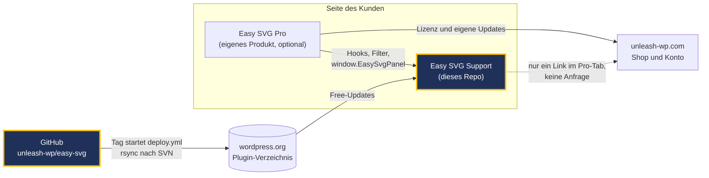
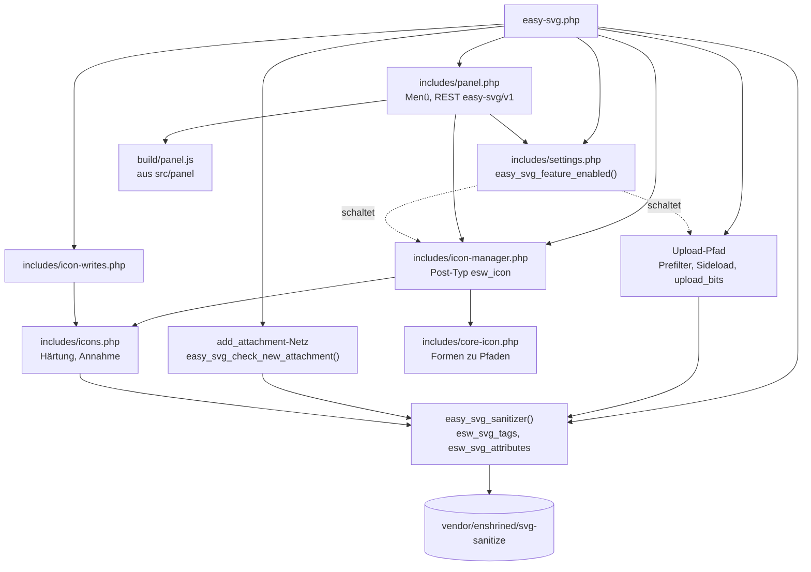
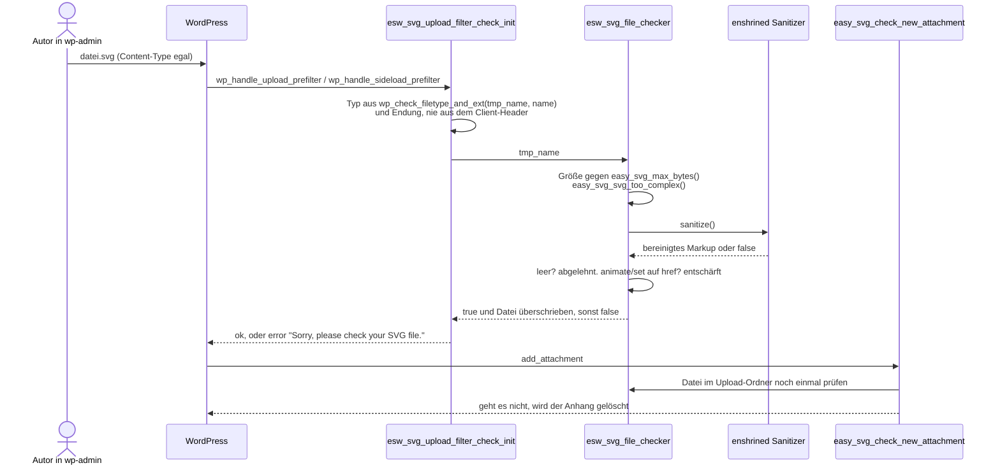
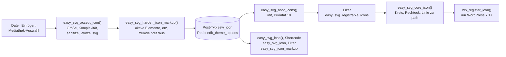
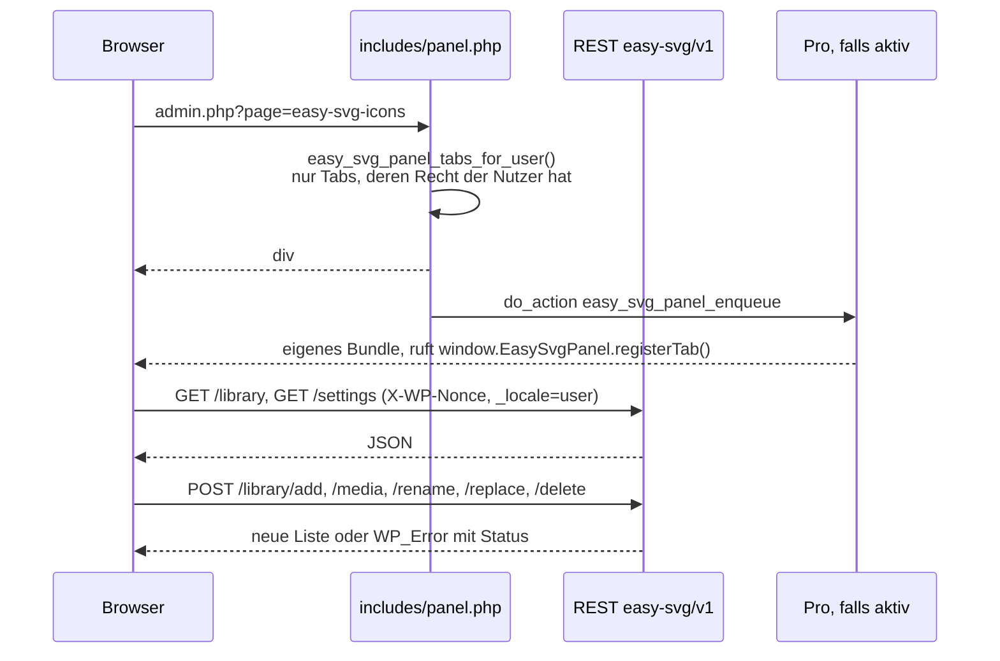
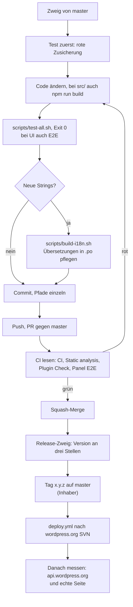
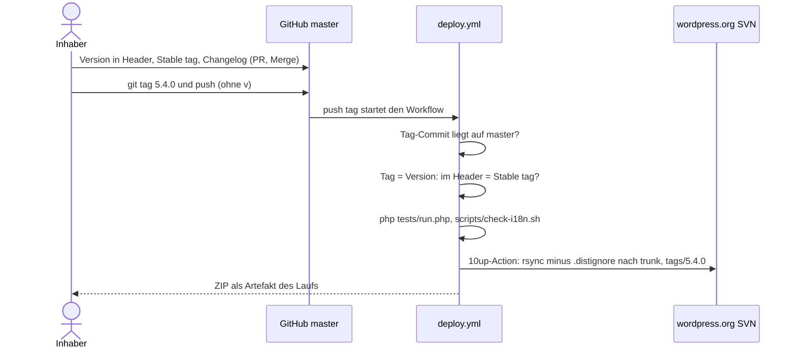

# Easy SVG Support: Wiki für Mitarbeiter

**Stand:** 2026-10-24 · **Standardzweig:** `master` · **Sichtbarkeit:** öffentlich ·
**Version im Header:** 5.4.0 · **auf wordpress.org ausgeliefert:** 4.1 (siehe [Release](#release-nach-wordpressorg))

Dieses Wiki liegt in `docs/` und wird nie ausgeliefert: `.distignore` und `.gitattributes`
halten den Ordner aus dem wordpress.org-Baum. Die Seite, die Kunden lesen, ist
[`readme.txt`](../readme.txt). Wer nur schnell etwas ausprobieren will, liest zuerst
[In 30 Sekunden](#in-30-sekunden) und [Eine Änderung hinzufügen](#eine-änderung-hinzufügen-schritt-für-schritt).

## Inhalt

1. [In 30 Sekunden](#in-30-sekunden)
2. [Wo es im Gesamtsystem sitzt](#wo-es-im-gesamtsystem-sitzt)
3. [Aufbau](#aufbau)
4. [Wie es funktioniert](#wie-es-funktioniert)
5. [Schnittstellen nach außen](#schnittstellen-nach-außen)
6. [Lokal einrichten und starten](#lokal-einrichten-und-starten)
7. [Tests und Prüfungen](#tests-und-prüfungen)
8. [Eine Änderung hinzufügen, Schritt für Schritt](#eine-änderung-hinzufügen-schritt-für-schritt)
9. [Release nach wordpress.org](#release-nach-wordpressorg)
10. [Fallen](#fallen)
11. [Glossar](#glossar)
12. [Wer entscheidet was](#wer-entscheidet-was)
13. [Verwandte Repos](#verwandte-repos)

## In 30 Sekunden

- **Was:** ein freies WordPress-Plugin. Es erlaubt SVG-Uploads und **bereinigt jede SVG auf dem Weg
  hinein** mit der mitgelieferten Bibliothek `enshrined/svg-sanitize`. Dazu kommt eine Icon-Bibliothek,
  deren Icons im Icon-Block von WordPress 7.1+ und per `easy_svg_icon()` nutzbar sind.
- **Für wen:** jede WordPress-Seite, rund 40.000 aktive Installationen über wordpress.org.
- **Wo es läuft:** auf den Seiten der Kunden. Das Plugin selbst stellt keine Anfrage nach außen;
  Updates kommen wie bei jedem Plugin aus dem Verzeichnis von wordpress.org.
- **Was es nicht ist:** Easy SVG Pro. Pro ist ein eigenes, kostenpflichtiges Produkt, das dieses Plugin
  voraussetzt und sich über öffentliche Hooks und das Panel-Register einklinkt. Kein Code von Pro liegt hier.
- **Grundregel:** Free ist vollständig und unbegrenzt (wordpress.org, Richtlinie 5). Nichts wird hinter
  einer Zahlung gesperrt, es gibt keine Icon-Obergrenze.

## Wo es im Gesamtsystem sitzt

Grob, und nur so weit, wie es für dieses Repo zählt:



Was du daraus mitnehmen sollst:

- **Free spricht mit niemandem.** Kein Tracking, kein Lizenzcheck, keine Anfrage nach außen. Es gibt nur
  Links: in der Plugin-Liste auf `https://www.unleash-wp.com` (`EASY_SVG_PRO_URL`, filterbar über
  `easy_svg_pro_url`) und im Pro-Tab des Panels auf die Produktseite von Pro.
- **Pro hängt an Free, nie umgekehrt.** Free prüft nur per `function_exists()`, ob Pro da ist
  (`easy_svg_pro_pro_enabled`, `easy_svg_pro_version`), um im Panel die richtige Ansicht zu zeigen.
- **Was Pro von Free braucht, ist ein Vertrag mit Nummer**: `EASY_SVG_API`, `EASY_SVG_PANEL_API`,
  `EASY_SVG_ICONS_API` (siehe [Schnittstellen](#schnittstellen-nach-außen)). Wer daran etwas ändert, ändert
  ein öffentliches Versprechen.

## Aufbau

```
easy-svg.php            Einstieg: Konstanten, Sanitizer, Upload-Pfad, Mediathek-Anzeige, Hook-Verdrahtung
includes/
  settings.php          Option easy_svg_settings (svg_upload, icons, max_mb), Migration auf 5.0
  icons.php             Reiner Icon-Kern: Slug, Härtung, Annahme, Registrierung (ohne WordPress testbar)
  core-icon.php         Übersetzt Formen und Striche in das, was die Icon-Registry von Core behält
  icon-manager.php      WordPress-Adapter um den Kern: Post-Typ esw_icon, Cache, Boot, easy_svg_add_icon()
  icon-writes.php       easy_svg_update_icon_markup(), easy_svg_rename_icon() (Icon-Vertrag)
  panel.php             Menü "Icons", Tabs, Assets, REST unter easy-svg/v1
uninstall.php           Löscht Icons, Optionen, Transients, auch je Seite im Multisite
src/                    Quellen des Panels (React 18, Chakra UI v3, Vite) - wird NICHT ausgeliefert
  panel/main.jsx        Mount auf #easy-svg-panel
  panel/App.jsx         Rahmen, Bereiche, Tabs, Pro-Platzhalter
  panel/registry.js     window.EasySvgPanel: registerTab, registerCollections, subscribe, get
  panel/api.js          REST-Client (Nonce im Header, _locale=user)
  panel/tabs/           Library.jsx, Settings.jsx, Upsell.jsx
  ui.jsx, theme.js      Bausteine und Tokens des UnleashWP-Designsystems
build/                  Gebautes Panel (panel.js, fonts/) - eingecheckt, wird ausgeliefert
public/fonts/           Ubuntu-Schrift, Quelle für build/fonts
assets/                 Menü-Icon, kleines Skript für den Hinweis am Icon-Block
languages/              .pot, .po/.mo/.json für de_DE, de_DE_formal, de_AT, de_CH, de_CH_informal
vendor/enshrined/       Mitgelieferter Sanitizer (eingecheckt, wird ausgeliefert)
tests/                  Reine PHP-Suites mit gestubbtem WordPress, zwei Node-Prüfungen
e2e/                    Playwright-Specs für das Panel (laufen gegen wp-env)
scripts/                test-all.sh, build-i18n.sh, check-i18n.sh, make-de-variants.php
tools/phpstan/          Eigene composer.json für PHPStan, damit nichts in vendor/ landet
.github/workflows/      ci, phpstan, plugin-check, e2e, deploy
.distignore             Was NICHT nach wordpress.org geht (gleiche Liste in .gitattributes)
```

Wie die Bausteine zusammenhängen:



Zum Codestil: 4 Leerzeichen Einzug (bewusst nicht der Tab-Standard von WordPress),
`declare(strict_types=1)` in jeder Datei außer `includes/icons.php` (dort hängt eine dokumentierte
Umwandlung von `false` zu `''` am Fehlen). Kommentare erklären das Warum in ein bis drei Zeilen.
Neue Funktionen heißen `easy_svg_*`; die `esw_*`-Namen bleiben, wie sie sind.

## Wie es funktioniert

### Schalter und Migration

`easy_svg_settings_defaults()` liefert `svg_upload => false`, `icons => false`, `max_mb => 2`. Auf einer
frischen Installation ist also **alles aus**, bis jemand es im Tab "Einstellungen" einschaltet. Die
Sicherheit ist **kein** Schalter: Bereinigen, Härten und die Größengrenze laufen immer.

Damit ein Update von 4.x nicht 40.000 Seiten die SVG-Uploads abschaltet, entscheidet
`easy_svg_migration_decision()` einmal je Seite (Option `easy_svg_schema` = `5.0`): Hat die Seite schon
SVG-Anhänge, bleibt `svg_upload` an, und `easy_svg_migration_notice()` sagt es einmal.

### Eine SVG wird hochgeladen

Zwei unabhängige Schichten. Keine allein ist der Schutz, beide müssen bleiben.



Die Bausteine im Einzelnen, alle in `easy-svg.php`:

| Schritt | Funktion | Hook | Wann aktiv |
|---|---|---|---|
| SVG erlauben | `esw_add_support()` | `upload_mimes` | `svg_upload` an; im Multisite nur, wenn die Netz-Option `upload_filetypes` `svg` enthält (abschaltbar: `easy_svg_respect_network_filetypes`) |
| Typ bestimmen | `esw_upload_check()` | `wp_check_filetype_and_ext` | `svg_upload` an |
| Prefilter | `esw_svg_upload_filter_check_init()` | `wp_handle_upload_prefilter`, `wp_handle_sideload_prefilter` | `svg_upload` an |
| Rohe Bytes | `easy_svg_upload_bits_check()` | `wp_upload_bits` | `svg_upload` an; lehnt ab statt zu bereinigen |
| Zweites Netz | `easy_svg_check_new_attachment()` | `add_attachment` | **immer**, auch mit Schalter aus |
| Maße | `easy_svg_svg_attachment_metadata()` | `wp_generate_attachment_metadata` | `svg_upload` an |
| Mediathek | `esw_display_svg_media()`, `esw_svg_styles()` | `wp_prepare_attachment_for_js`, `admin_head` | immer |
| Veralteter Sanitizer | `easy_svg_outdated_sanitizer_notice()` | `admin_notices` | wenn ein anderes Plugin eine ältere enshrined-Version zuerst geladen hat |

**CVE-2025-12451 ist behoben.** Die Lücke (Stored XSS ab Rolle Autor über eine SVG mit gefälschtem
`Content-Type`, betroffen bis 4.0) entstand, weil der Typ aus `$_FILES['type']` kam. Seit der
Überarbeitung entscheidet nur die Server-Seite: `wp_check_filetype_and_ext()` plus Endung. Ein
Regressionstest in `tests/run.php` lädt eine SVG mit `<script>` als `image/gif` und `image/png` hoch und
erwartet dasselbe Ergebnis wie bei ehrlichem Typ. Wer diesen Pfad anfasst, bricht diesen Test zuerst.

Was die Grenzen bedeuten:

- `easy_svg_max_bytes()`: `max_mb` aus den Einstellungen (1 bis `easy_svg_max_mb_ceiling()`, Standard 20)
  in Bytes, danach Filter `easy_svg_max_bytes`.
- `easy_svg_svg_too_complex()`: Größe ist nicht Rechenzeit. Mehr als `easy_svg_max_php_tags` (10)
  `<?`-Stellen oder mehr als `easy_svg_max_use_tags` (1000) `<use` werden vor dem Parsen abgelehnt, weil
  zwei Pfade der Bibliothek quadratisch wachsen.
- `esw_svg_remove_remote_references` (Standard `true`): Verweise auf fremde Server werden entfernt.

### Icons speichern und ausgeben



- Gespeichert wird im privaten Post-Typ `esw_icon` (Sammlung `easy-svg`). Die Liste liegt im Transient
  `easy_svg_icons`; `save_post_esw_icon` und `deleted_post` werfen ihn weg.
- **Icons tragen nichts Aktives.** Core fügt das Markup des Icon-Blocks direkt in die Seite ein, darum
  härtet `easy_svg_harden_icon_markup()` zusätzlich zum Sanitizer.
- **Core behält wenig.** `WP_Icons_Registry` lässt nur `svg`, `path`, `polygon` und wenige Attribute
  durch, ohne Filter. `includes/core-icon.php` rechnet Kreis, Rechteck, Ellipse, Linie, Polylinie und
  Gruppen in Pfade um und legt Striche als Klasse `esvg-stroke` plus kleines Stylesheet
  (`easy_svg_print_stroke_css`) wieder an. Sonst kämen Strich-Icons (Feather, Lucide, Tabler) als leere
  Kästchen an.
- Ohne 7.1 bleibt der Template-Weg: `easy_svg_icon( 'name' )` oder `easy_svg_icon( 'sammlung/name' )`,
  Argumente `class`, `label`, `decorative`. Shortcode: `[easy_svg_icon name="..." label="..."]`.

### Das Panel

Menüpunkt **Icons** (Slug `easy-svg-icons`, Position `99.7`) mit den Tabs "Icon library" und "Settings",
dazu ein Tab "Pro". Die Seite ist eine einzige Admin-Seite; jeder Tab ist dieselbe Seite mit `&tab=`.



- Der Bildschirm ist nie die Instanz, die entscheidet. Jede REST-Route prüft selbst
  (`easy_svg_panel_rest_permission()` = `manage_options`), jeder Handler liest seine Eingabe neu.
- `POST /settings` mischt auf das **Gespeicherte**, nicht auf die Standardwerte. Sonst würde ein Body,
  der nur `max_mb` nennt, beide Schalter abschalten und trotzdem 200 sagen.
- Mediathek-Auswahl geht über IDs, nie über Bytes im Browser: `POST /library/media` liest die Anhänge
  auf dem Server. Eine ausgelagerte Mediathek liefert von einer anderen Origin, ein `fetch` im Browser
  scheitert dort an CORS.
- Die Vorschau bereinigt Eingefügtes zusätzlich mit DOMPurify, bevor es `innerHTML` berührt. Der Server
  bereinigt beim Speichern trotzdem neu.
- `build/panel.js` ist eingecheckt und ist das, was Kunden ausführen. Eine Änderung in `src/` ohne
  `npm run build` liefert das alte Panel; CI fällt dann rot.

### Übersetzungen und Locale-Varianten

- `easy_svg_load_textdomain()` läuft auf `init` mit Priorität 1 und lädt **zweimal**: erst
  `load_plugin_textdomain()` (das Paket von translate.wordpress.org gewinnt jede Kollision), dann die
  mitgelieferte `.mo` per `load_textdomain()` für die Lücken. Der erste Aufruf allein reicht nicht: er
  kehrt zurück, sobald ein Paket von wordpress.org geladen ist, und sieht nie in `languages/`.
- Fünf Locales werden mitgeliefert. `de_DE_formal` wird aus `de_DE` über
  `languages/de_DE_formal.map.json` und `scripts/make-de-variants.php` abgeleitet; das Skript bricht ab,
  wenn ein neuer Satz mit Du-Anrede keine Sie-Fassung hat.
- Die JSON-Kataloge für das Panel sind nach dem md5 des Pfads `build/panel.js` benannt. Darum schreibt
  `build-i18n.sh` die JS-Verweise im POT auf `build/panel.js` um, behält aber die `translators:`-Kommentare
  aus `src/`.
- Neue Strings kommen nur über `msgmerge` in die `.po`; `scripts/build-i18n.sh` macht das,
  `scripts/check-i18n.sh` prüft es in CI und vor jedem Deploy.

## Schnittstellen nach außen

### PHP-Hooks und Funktionen

**Das Präfix `esw_` ist öffentliche API. Nie umbenennen**, auch wenn Plugin Check es anmahnt: Seiten
und Add-ons filtern diese Namen. Neue Namen beginnen mit `easy_svg_`.

| Name | Art | Wer nutzt es | Was es tut / gibt zurück |
|---|---|---|---|
| `esw_svg_allowed_tags` | Filter | Seiten, Pro | Erlaubte Elemente des Sanitizers (Array) |
| `esw_svg_allowed_attributes` | Filter | Seiten, Pro | Erlaubte Attribute (Array) |
| `esw_svg_remove_remote_references` | Filter | Seiten | `true` (Standard) entfernt fremde Verweise |
| `easy_svg_max_bytes` | Filter | Seiten, Pro | Größengrenze in Bytes |
| `easy_svg_max_mb_ceiling` | Filter | Pro | Obergrenze des Felds "max_mb" (Standard 20) |
| `easy_svg_max_php_tags`, `easy_svg_max_use_tags` | Filter | Seiten | Komplexitätsgrenzen (10, 1000) |
| `easy_svg_respect_network_filetypes` | Filter | Multisite | `false` erlaubt SVG trotz Netz-Liste |
| `easy_svg_icon_markup` | Filter | Pro | Markup für `($slug, $collection)` liefern oder ändern |
| `easy_svg_registrable_icons` | Filter | Pro | Icons vor der Registrierung bei Core |
| `easy_svg_panel_menu_tabs` | Filter | Pro | Tabs mit eigenem Menüeintrag, `slug => label` oder `['label','capability']` |
| `easy_svg_panel_enqueue` | Action | Pro | Eigenes Bundle mit `easy-svg-panel` als Abhängigkeit laden |
| `easy_svg_pro_url` | Filter | Seiten | Ziel des Links in der Plugin-Liste |
| `easy_svg_sanitizer()` | Funktion | Add-ons | Sanitizer mit der Allow-Liste dieser Seite, oder `null` |
| `easy_svg_icon()`, `[easy_svg_icon]` | Funktion, Shortcode | Themes | Icon als SVG-Markup, `''` wenn unbekannt |
| `easy_svg_add_icon()` | Funktion | Add-ons | Icon über den vollen Annahmeweg speichern |
| `easy_svg_update_icon_markup()`, `easy_svg_rename_icon()` | Funktion | Pro | Bytes oder Namen eines Icons ändern, über dieselben Grenzen |
| `$GLOBALS['sanitizer']` | Global | alte Snippets | Der Sanitizer von 4.1, bleibt für `removeRemoteReferences()`-Aufrufe |

### Vertragsnummern

| Konstante | Wert | Deckt ab |
|---|---|---|
| `EASY_SVG_API` | 3 | `easy_svg_sanitizer()` und seine Form |
| `EASY_SVG_PANEL_API` | 3 | `easy_svg_panel_enqueue`, `easy_svg_panel_menu_tabs`, `easy_svg_max_mb_ceiling`, `registerTab()` mit `area`/`icon`/`capability` (2), `registerCollections()` (3) |
| `EASY_SVG_ICONS_API` | 3 | `easy_svg_registrable_icons`, `easy_svg_rename_icon()` (2), `easy_svg_update_icon_markup()` (3) |

Ein Filter lässt sich nicht abfragen, darum hat jeder Vertrag eine eigene Zahl. Erhöhen nur, wenn sich die
Form ändert, und im Docblock in `easy-svg.php` sagen, was die neue Stufe hinzufügt. Eine Erhöhung ist ein
Release-Thema für Pro gleich mit.

### JavaScript: `window.EasySvgPanel`

Definiert in `src/panel/registry.js`. Pro bündelt die Datei nicht, sondern greift auf das globale Objekt zu.

| Aufruf | Zweck |
|---|---|
| `registerTab({ id, render, area, icon, capability, order })` | Tab in einen der Bereiche hängen |
| `registerCollections({ id, load, ... })` | Sammlungen in die eine Bibliothek geben (ab Stufe 3) |
| `subscribe(fn)`, `get(id)` | Neu zeichnen bei Änderung, Tab nachschlagen |
| `api` | Vertragsstufe, aus `EasySvgPanelData.panelApi` |

Daten für das Bundle: `window.EasySvgPanelData` (nicht `...Config`), unter anderem `panelApi`, `tabCaps`,
`caps`, `restRoot`, `nonce`, `version`, `proActive`, `proVersion`, `proLicensed`, `iconsEnabled`,
`iconBlock`, `maxMbCeiling`.

### REST unter `easy-svg/v1`

Alle Routen verlangen `manage_options` und einen `wp_rest`-Nonce im Header `X-WP-Nonce`.

| Methode | Pfad | Body | Antwort | Fehler |
|---|---|---|---|---|
| GET | `/settings` | | `{svg_upload, icons, max_mb}` | 401/403 ohne Recht |
| POST | `/settings` | beliebige Teilmenge davon | gespeicherte Einstellungen | gemischt auf Gespeichertes, `max_mb` geklemmt |
| GET | `/library` | `?search=` | Liste der Icons (höchstens 500) | |
| POST | `/library/add` | `{markup, label}` | neue Liste | 409 `easy_svg_no_store` (Bibliothek aus), 422 `easy_svg_add_failed` |
| POST | `/library/media` | `{ids: [int]}` (höchstens 25) | neue Liste mit Ergebnis je ID | 409, 400 `easy_svg_no_ids` |
| POST | `/library/rename` | `{id, label}` | neue Liste | 404 `easy_svg_no_icon`, 422 `easy_svg_bad_label`, 500 `easy_svg_rename_failed` |
| POST | `/library/replace` | `{id, markup}` | neue Liste | 404, 422 `easy_svg_replace_refused` |
| POST | `/library/delete` | `{id}` | neue Liste | 404, wenn kein `esw_icon` |

Optionen in der Datenbank: `easy_svg_settings`, `easy_svg_schema`, `easy_svg_icons_version`; Transients
`easy_svg_icons`, `easy_svg_5_notice`. `uninstall.php` löscht genau diese und alle `esw_icon`-Posts.

## Lokal einrichten und starten

Voraussetzungen: PHP 8.0 oder neuer, Node 20, für die Übersetzungsprüfung wp-cli und gettext,
für E2E und Plugin Check Docker.

```bash
git clone https://github.com/unleash-wp/easy-svg.git
cd easy-svg
npm ci                      # Panel-Werkzeuge; vendor/ ist eingecheckt, kein composer install nötig
npm run build               # build/panel.js aus src/ (nach jeder Änderung in src/)
npm run dev                 # dasselbe im Watch-Modus
```

Eine echte WordPress-Seite mit diesem Plugin:

```bash
npx wp-env start            # @wordpress/env ist devDependency; Port 8888, admin/password
npx wp-env stop
```

Das Plugin ist danach aktiv, aber **alles ist aus**. Im Menü "Icons" unter "Settings" die SVG-Uploads
und die Icon-Bibliothek einschalten. Für einen schnellen Blick in echtes WordPress ohne Docker geht auch
WordPress Playground, aber nicht für Plugin Check (siehe Fallen).

## Tests und Prüfungen

Die schnelle Runde, alles ohne Docker, ausgewertet **am Exit-Code**:

```bash
scripts/test-all.sh         # meldet nur, was ROT ist; Exit != 0, wenn etwas rot ist
```

| Suite | Befehl | Was sie beweist | Typisches Falschbestehen |
|---|---|---|---|
| Kern | `php tests/run.php` | Upload-Pfad, Sanitizer, CVE-Regression, Mediathek, Versionen Header = Stable tag, `.distignore` = `.gitattributes`, startet die anderen PHP-Suites mit | Ausgabe durch `tail` gelesen: dann zählt der Exit-Code von `tail` |
| Icons | `php tests/icons.php` | Slug, Härtung, Annahme, Registrierung | |
| Core-Icon | `php tests/core-icon.php` | Formen zu Pfaden, Striche | |
| Panel REST | `php tests/panel-rest.php` | Routen, Teil-Schreiben, Fehlercodes | |
| Panel-Zugriff | `php tests/panel-access.php` | Wer welchen Tab und welches Menü sieht | |
| Runner | `php tests/runner.php` | Kein Workflow läuft auf einem selbst gehosteten Runner | |
| Bundle | `node tests/build-swap.mjs` | Ein Build lässt `build/` nie ohne ganzes Bundle | ohne `npm ci` scheitert er an fehlendem vite, nicht am Code |
| Hinweise | `node tests/notice-status.mjs` | Jeder Hinweis nennt seinen Status | |
| Kataloge | `scripts/check-i18n.sh` | Jeder String übersetzt, `.mo` und `.json` passen zur `.po` | ohne wp-cli/gettext bricht es ab, das ist kein Grün |
| Lint | `npm run lint` | ESLint über `src/` | |
| PHPStan | `composer install --working-dir=tools/phpstan` dann `tools/phpstan/vendor/bin/phpstan analyse --memory-limit=1G` | Stufe 5, PHP 8.0 bis 8.4 | mit 128M stirbt es mit einer Zeile, die wie "sauber" aussieht |
| E2E | `npx wp-env start` dann `npm run test:e2e` | Das gebaute Panel im Browser, auf einer frischen leeren Seite | lokal gefüllte Bibliothek verdeckt den Leerzustand |
| Plugin Check | in CI auf dem Versandbaum | Was wordpress.org bekommt | Arbeitskopie statt Versandbaum geprüft |

CI (`.github/workflows/`):

- `ci.yml`: PHP 8.0 und 8.4, `php -l` über alles außer `vendor/`, ESLint, `notice-status`, **das
  eingecheckte Bundle muss das sein, was die Quellen bauen**, `tests/run.php`, Kataloge (nur 8.4),
  `runner.php`, `icons.php`, `panel-rest.php`, kein Hook-Name mit Großbuchstaben.
- `phpstan.yml`: Stufe 5.
- `plugin-check.yml`: baut den Versandbaum mit `git archive HEAD --prefix=easy-svg/` und lässt die
  offizielle Plugin-Check-Action darüber laufen. Warnungen sind sichtbar gelassen, Fehler lassen den Job
  scheitern. Die erwarteten Warnungen (die `esw_`-Namen, `vendor/` ohne `composer.json`,
  `load_plugin_textdomain()`) stehen im Workflow mit Begründung.
- `e2e.yml`: `npm ci`, `npm run build`, Chromium, `npx wp-env start`, `::1` aus `/etc/hosts`, Specs.
- Alle laufen auf von GitHub gehosteten Runnern. Das Repo ist öffentlich; `tests/runner.php` hält das fest.

Neue Zusicherungen werden **mutationsgeprüft**: Code absichtlich kaputt machen, die Suite muss rot werden,
dann zurück. Eine Prüfung, die nur am erwarteten Grün gezeigt wurde, beweist nichts.

## Eine Änderung hinzufügen, Schritt für Schritt



1. **Zweig.** `git switch -c fix/kurzer-name origin/master`. Nie direkt auf `master`.
2. **Test zuerst.** Die Zusicherung schreiben, die heute rot ist. Suite laufen lassen, Rot sehen.
3. **Ändern.** PHP in `easy-svg.php` oder `includes/`, Panel in `src/`. Nach `src/` immer `npm run build`
   und `build/` mit committen.
4. **Prüfen.** `scripts/test-all.sh` und `echo $?`. Bei Panel-Änderungen zusätzlich E2E. Neue Prüfung
   einmal mutieren.
5. **Strings.** Neue oder geänderte Texte: `scripts/build-i18n.sh`, dann die fünf `.po` übersetzen
   (keine Gedankenstriche in Oberflächentexten, Sie-Fassung für `de_DE_formal` über die Map), noch einmal
   `scripts/build-i18n.sh`, dann `scripts/check-i18n.sh`.
6. **Commit.** Dateien einzeln mit `git add <pfad>`, nie `git add -A`. Betreff im Stil des Repos: ein Satz,
   der sagt, was jetzt wahr ist ("Renaming opens beside the icon, ..."). Autor Benjamin Zekavica, keine
   Co-Author- oder Generator-Zeile.
7. **PR.** Gegen `master`, kurze sachliche Beschreibung. `gh pr checks <nummer>` lesen, bei Rot
   `gh run view <id> --log-failed`. Die E2E-Suite auf CI ist die einzige Messung einer frischen, leeren
   Seite: lokal grün heißt dort nichts.
8. **Merge.** Squash-Merge, wenn alles grün ist.
9. **Release.** Nur wenn es zum Kunden soll, siehe [Release](#release-nach-wordpressorg).
10. **Danach messen.** `https://api.wordpress.org/plugins/info/1.0/easy-svg.json` zeigt die ausgelieferte
    Version; auf einer Testseite das Update holen und die Änderung ansehen.

### Durchgespielt: ein Element mehr für die Größengrenze

Angenommen, du willst die Obergrenze für `<use>`-Elemente anheben, weil ein Kunde ein großes Sprite hat.

- **Datei:** `easy-svg.php`, `easy_svg_svg_too_complex()` (der Standard `1000` im Filter
  `easy_svg_max_use_tags`). Vorher fragen, ob ein Filter auf der Seite nicht reicht: der existiert schon.
- **Test:** in `tests/run.php` den Abschnitt zu `easy_svg_svg_too_complex` suchen
  (`grep -n too_complex tests/run.php`), eine Zusicherung mit genau der neuen Grenze und eine mit Grenze
  plus eins schreiben. Laufen lassen, die erste muss rot sein.
- **Befehl:** `php tests/run.php; echo $?`, dann `scripts/test-all.sh`.
- **Mutation:** den Vergleich `>` kurz auf `>=` drehen, die neue Zusicherung muss rot werden. Zurück mit
  dem Editor, nicht mit `git checkout <datei>` (das wirft alles Ungespeicherte weg).
- **Kein String geändert,** also kein `build-i18n.sh`. Steht die Grenze in `readme.txt`, ändert das der
  Inhaber im Release-Zweig.
- Commit, PR, CI lesen, Merge. Kein Tag ohne den Inhaber.

## Release nach wordpress.org

Kein Zwischenschritt: **der Tag ist der Knopf.** Den Tag setzt der Inhaber.



Der genaue Ablauf und die einmalige Einrichtung stehen in [`RELEASING.md`](../RELEASING.md). Kurz:

1. Version an drei Stellen gleich: `Version:` in `easy-svg.php`, `Stable tag:` in `readme.txt`, ein
   Eintrag `= x.y.z =` im Changelog (und ein Upgrade Notice unter 300 Zeichen, wenn nötig).
2. CI auf `master` grün.
3. Tag mit der nackten Versionsnummer setzen und pushen.

**Stand am 2026-10-24:** Die Tags `5.1.0` bis `5.3.1` haben den Deploy gestartet, jeder Lauf hielt am
SVN-Schritt an, weil die Zugangsdaten für wordpress.org im Repo nicht hinterlegt sind. wordpress.org
liefert deshalb weiter **4.1**. `master` trägt 5.4.0, ungetaggt. Vor jeder Aussage über "die aktuelle
Version" drei Dinge getrennt messen: die API von wordpress.org, `git ls-remote --tags origin`, den Header
auf `master`.

Den Versandbaum ansehen, ohne zu deployen (beide Wege ergeben denselben Baum, `tests/run.php` prüft
die Listen gegeneinander):

```bash
git archive --format=tar --prefix=easy-svg/ HEAD | tar -t
rsync -rc --exclude-from=.distignore ./ /pfad/zum/leeren/ordner/easy-svg/
```

Der `rsync`-Weg ist das, was die Deploy-Action tut; lokal nur auf einem sauberen Checkout, sonst
führen nicht eingecheckte Dateien mit. Nie ein ZIP aus der Arbeitskopie bauen.

Banner, Icons und Screenshots liegen in SVN `assets/` und werden nicht aus diesem Repo verwaltet.

## Fallen

| Symptom | Ursache | Richtig |
|---|---|---|
| Suite "grün", aber der Commit lag auf einem roten Baum | `php tests/x.php \| tail -3` liefert den Exit-Code von `tail` | `scripts/test-all.sh` oder `php tests/x.php; echo $?` |
| Änderung im Panel "wirkt nicht" beim Kunden | `src/` geändert, `build/` nicht neu gebaut | `npm run build`, `build/` committen; CI-Schritt "The committed bundle..." |
| Neue Strings auf deutschen Seiten englisch, Suite grün | POT neu, aber `.po` lernt keine msgid von allein | `scripts/build-i18n.sh` (mit `msgmerge`), `scripts/check-i18n.sh` |
| Mitgelieferte Übersetzung wird nie geladen | `load_plugin_textdomain()` kehrt zurück, sobald ein wordpress.org-Paket da ist | zweites `load_textdomain()` mit Pfad, so wie in `easy_svg_load_textdomain()` |
| Panel "falsch" in Du-Form auf einer `de_DE_formal`-Seite | Im wp-admin gilt die Profilsprache des Nutzers | immer `WPLANG` **und** `get_user_option('locale')` messen |
| Plugin Check meldet Dutzende Fehler in `tests/` | Arbeitskopie geprüft | Versandbaum prüfen, Ordner heißt `easy-svg` (sonst falsche Textdomain) |
| Plugin Check meldet versteckte Dateien | macOS-`tar` packt `._*` mit | `COPYFILE_DISABLE=1 tar ...`, vorher `find . -name '._*'` |
| `wp plugin check` Exit 0 trotz ERRORs | Der Befehl wertet nicht | Befunde zählen; die CI-Action tut das |
| Plugin Check in Playground stürzt ab | PHPCS braucht Prozesse, die WebAssembly nicht hat | wp-env oder echte Seite |
| `npx wp-env` startet nichts | Fremdes Paket `wp-env` aus der Registry | `@wordpress/env` ist devDependency, `npx wp-env` im Repo nutzt es |
| E2E auf CI: Verbindung abgelehnt | Runner löst `localhost` zuerst auf `::1`, wp-env hört nur IPv4 | `::1`-Zeile aus `/etc/hosts`, nicht auf `127.0.0.1` ausweichen (Nonce und Assets von anderer Origin) |
| Login im E2E klappt nur manchmal | WordPress tauscht das Passwortfeld beim Laden aus | per POST an `wp-login.php` anmelden (`e2e/auth.setup.js`) |
| Lokal grün, CI-E2E rot | Lokal ist die Bibliothek gefüllt, CI ist leer | Specs, die vom Inhalt abhängen, mit `page.route` auf leere Antwort stellen |
| E2E-Lauf ohne Aussage | Während des Laufs gebaut | Nie bauen, solange E2E gegen dieselbe Seite läuft |
| Mediathek-Auswahl zeigt leeren Uploader | `wp.media` öffnet auf "Upload files" und lädt die Liste erst beim Tab-Wechsel | `frame.on('open', () => frame.content.mode('browse'))` |
| Speichern eines Felds schaltet andere ab | REST-Body über den Formular-Sanitizer mit Standardwerten | auf das Gespeicherte mischen (`easy_svg_panel_settings_post`) |
| Umbenanntes Icon ist leer | `wp_update_post()` schreibt die Zeile neu, kses kennt kein SVG | nur über `easy_svg_rename_icon()` / `easy_svg_update_icon_markup()` |
| Strich-Icon im Icon-Block ist ein leeres Kästchen | Core behält nur `path`/`polygon`, keinen `stroke` | über `easy_svg_core_icon()` registrieren, nicht am Kern vorbei |
| Hook feuert nie | Großbuchstabe im Hook-Namen | Core baut Namen klein; CI-Schritt "No hook name..." |
| Test mit Dateiliste bleibt grün, obwohl Dateien umzogen | Leere Liste, `str_contains` auf `''` ist wahr | jede Prüfung über eine feste Liste sichert zu, dass die Liste aufgelöst wurde |
| Arbeit nach einem Mutationstest weg | `git checkout <datei>` setzt auf den letzten Commit zurück | vorher committen oder im Editor zurücknehmen |
| Deploy nach Tag rot am SVN-Schritt | Zugangsdaten für wordpress.org fehlen im Repo | Inhaber hinterlegt sie (siehe `RELEASING.md`), dann Tag neu auslösen |

## Glossar

| Begriff | Bedeutung hier |
|---|---|
| Sanitizer | `enshrined/svg-sanitize` in `vendor/`, über `easy_svg_sanitizer()` mit der Allow-Liste der Seite |
| Allow-Liste | Erlaubte Elemente und Attribute, erweiterbar über die `esw_svg_allowed_*`-Filter |
| Prefilter | Die erste Schicht: prüft und bereinigt die Datei, bevor WordPress sie ablegt |
| Netz | Die zweite Schicht auf `add_attachment`, immer aktiv |
| Härtung | `easy_svg_harden_icon_markup()`: nimmt Icons zusätzlich alles Aktive |
| Icon-Store | Post-Typ `esw_icon`, privat, Recht `edit_theme_options` |
| Sammlung | Gruppe von Icons; Free hat `easy-svg`, Add-ons bringen eigene über `registerCollections()` |
| Vertrag | Eine der drei `EASY_SVG_*_API`-Konstanten und was sie verspricht |
| Panel | Die React-App unter "Icons", gebaut nach `build/panel.js` |
| Bereich | Gruppe im linken Rail des Panels (`area` beim Registrieren eines Tabs) |
| Stable tag | Die Version in `readme.txt`, die wordpress.org ausliefert |
| Versandbaum | Das Repo minus `.distignore`, also das, was in SVN landet |
| Locale-Variante | `de_DE_formal`, `de_AT`, `de_CH`, `de_CH_informal`, abgeleitet aus `de_DE` |
| wp-env | Lokale WordPress-Seite in Docker, `.wp-env.json` im Repo |
| Plugin Check | Offizielle Prüfung von wordpress.org, hier in CI auf dem Versandbaum |
| Pro | Easy SVG Pro, separates Produkt; Lizenz, Plätze und Updates gehören dorthin, nicht hierher |

## Wer entscheidet was

| Thema | Wer |
|---|---|
| Tag setzen, also veröffentlichen | Inhaber |
| Repo-Secrets und Einstellungen (Schutz für Tags, Runner) | Inhaber |
| Etwas entfernen, auch was "tot" aussieht | Inhaber |
| Versionsnummern, `readme.txt`, Changelog | Inhaber, im Release-Zweig |
| Antworten an das Plugin-Team von wordpress.org | Inhaber |
| Zweig, Tests, PR, Review | wer die Änderung baut |
| Merge eines grünen PR | nach Absprache mit dem Inhaber |

Feste Regeln: Commits und PRs als Benjamin Zekavica, ohne Spuren von Werkzeugen. Nie `git add -A`.
Keine Gedankenstriche in Oberflächentexten und Übersetzungen. Release-Tags werden nie verschoben.

## Verwandte Repos

- [unleash-wp/wp-dodo-checkout](https://github.com/unleash-wp/wp-dodo-checkout), öffentlich: der
  Checkout auf den Verkaufsseiten, eigenes [`docs/wiki.md`](https://github.com/unleash-wp/wp-dodo-checkout/blob/main/docs/wiki.md).
- Easy SVG Pro und die Dienste dahinter sind privat und nicht Teil dieses Repos. Was Free ihnen
  verspricht, steht vollständig in [Schnittstellen nach außen](#schnittstellen-nach-außen).
- Upstream: [darylldoyle/svg-sanitizer](https://github.com/darylldoyle/svg-sanitizer) (`enshrined/svg-sanitize`).
  Funde in der Bibliothek werden dort gemeldet, nicht hier gepatcht.
